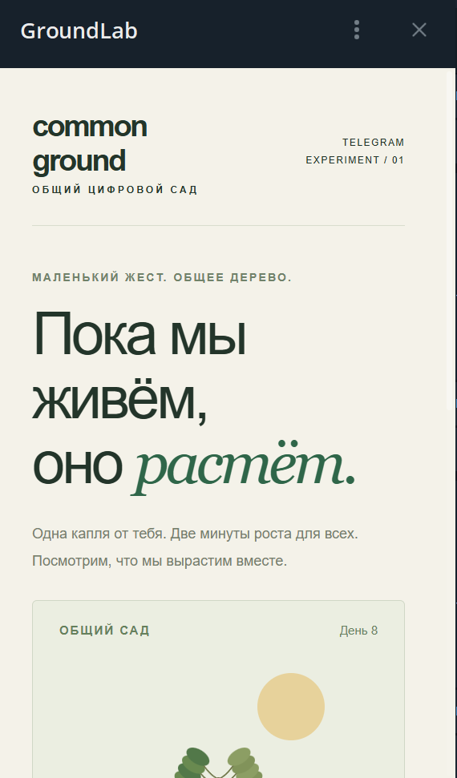

# Telegram Serverless vs. two VPSs

A working Telegram bot and Mini App, plus the code and raw measurements behind a comparison with two existing VPSs. The experiment asks what Telegram Serverless removes from a small bot deployment, and how its SQL, JavaScript and outbound HTTP behave on the tested workload.

[Русская инструкция](README.ru.md) · [Try the bot](https://t.me/commongroundlabbot) · [Full benchmark report](benchmark/extended/report.md) · [Metrics CSV](benchmark/extended/results/metrics.csv)

## The experiment

Common Ground Lab is a shared digital garden. Everyone waters one tree; a watering contributes 120 growth units over two minutes. Each user has one accepted watering per fixed Unix-minute bucket. Growth is calculated from stored timestamps when the garden is read. No always-running timer is needed.

The initial bot was built in one iteration with 6.1 Sol, then checked locally and in Telegram. Implementation, measurement tooling and documentation used AI assistance. The experiment was expanded after the first three SQL cases proved too narrow to judge an entire platform.



The interface is in Russian. Send /start to the bot, choose «Открыть сад» (Open garden), and water the tree. The first 14 gardeners in the archived chat screenshot are synthetic test actors, not audience figures.

## Results at a glance

Measured October 17, 2026. These are results of the described workloads, not a general hosting ranking.

| Case, median milliseconds | Finland VPS | Germany VPS | Telegram |
|---|---:|---:|---:|
| Primary-key lookup | 0.009 | 0.013 | 2 |
| 32 separate INSERT statements | 18.16 | 95.48 | 533 |
| One INSERT of 32 rows | 0.69 | 0.53 | 16 |
| Read garden, 1,000 records | 0.26 | 0.25 | 7 |
| CPU integer-mixing test | 1.92 | 1.96 | 2.06 |
| JSON processing test | 29.84 | 34.21 | 11.08 |

Both VPSs ran Node.js 22.23.3, SQLite 3.51.3, WAL/FULL, on persistent ext4. Each had one vCPU and roughly 2 GB RAM. A preliminary setup used RAM-backed /tmp on Finland; those database timings are archived and excluded from the final disk comparison.

SQL medians use warmed per-operation samples. CPU and JSON use the median of 30 block means, calculated from repeated work; those are different distributions. Telegram's internal clock did not advance for pure CPU work, so compute blocks use server-reported execution duration. The full report records the timer and adapter differences.

At the observed SQL boundaries, a 10,000-row INSERT and a sum over 50,000 rows succeeded; 10,001 inserted rows and a sum over 50,001 rows were rejected. A key lookup in a 100,001-row table still worked. These are query limits observed on the early-access account, not database-size limits or guaranteed public quotas.

The benchmark also includes 1/4/8-way SQL concurrency, outbound HTTP, empty invocations and garden sizes of 1,000/10,000/100,000 rows. It does not measure client-visible Telegram latency, cold starts or peak user throughput. Existing VPS applications continued running.

## Run the local demo

Use Node.js 22.13+ with node:sqlite. The local tests were also run on Node.js 24.19.0.

```sh
node --test tests/garden.test.mjs
node tools/preview.mjs
```

Open http://127.0.0.1:8765/?demo=1. The demo uses browser-local storage and is explicitly labelled. It does not call the live cloud database.

## Deploy your own bot

Get Serverless access for your own test bot in @BotFather. Use the separate CLI Access token with the interactive login command. Do not put a token into source files.

```sh
npm install
npx tgcloud login
npx tgcloud push
npx tgcloud migrate --dry-run
npx tgcloud migrate --safe
```

Set MINI_APP_URL in tgcloud/lib/config.js to the URL printed for **your** deployment, then push that file. The committed URL belongs to the public demonstration bot. Uploading code and applying the schema are separate steps.

Open the app through your bot so Telegram can supply verified init data. On a standalone website without Telegram authorization, the page asks you to open it inside Telegram.

## What is included

- tgcloud/: schema, message/callback handlers, shared model and Mini App endpoints.
- web/: static interface, with no frontend build step.
- tests/: local SQLite and concurrency checks.
- benchmark/extended/: collectors, isolated fixtures, raw phases, final aggregates and methodology.
- illustrations/: the flow diagram, a generated comparison table and labelled walkthrough illustrations.

To reproduce live measurements, use your own VPS SSH aliases, Linux Node binary and test-bot access; see [benchmark setup](benchmark/extended/README.md). To recalculate the supplied data without any credentials:

```sh
node benchmark/extended/consolidate.mjs
node benchmark/extended/summarize.mjs
```

The live bot stores participant Telegram IDs and watering timestamps internally to enforce its limit. This repository contains synthetic benchmark fixtures, aggregate counts and the two supplied public screenshots. It excludes credentials, private SSH configuration, server addresses, manual-user logs and real participant IDs.

The original model scans the full watering history. Its 100,000-record cloud test hit a query-read limit; it is a prototype, not a proven large-scale design. The experiment incurred no hosting charge in early access. Public future pricing and a permanent free tier are not established by these tests.

References: [Telegram Serverless](https://core.telegram.org/bots/serverless), [Mini Apps](https://core.telegram.org/bots/webapps#serverless).

## Published articles

- [Русская статья на Хабре](https://habr.com/ru/articles/1095716/)
- [English article on DEV](https://dev.to/jabrailkhalil/telegram-serverless-vs-two-vpss-what-the-benchmarks-actually-show-44p8)
